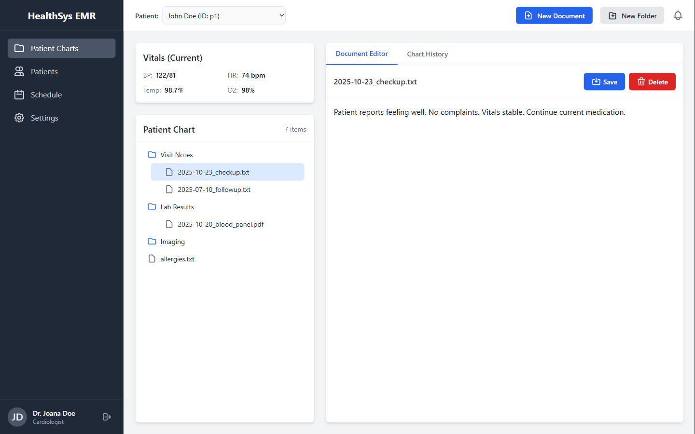
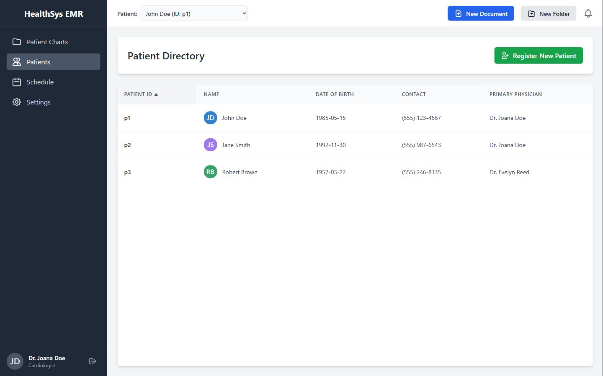
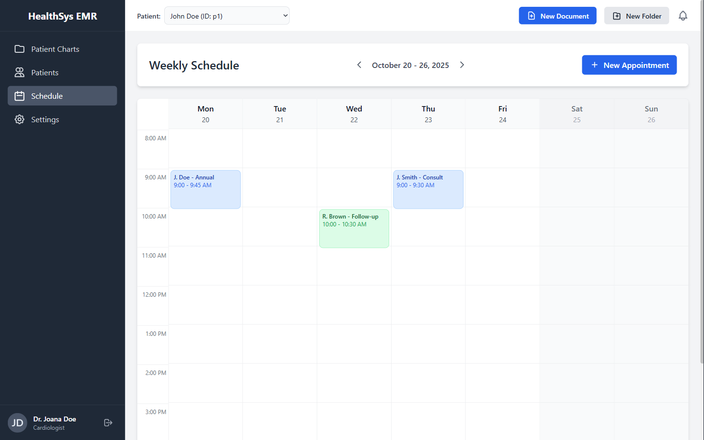

# HealthSys EMR

A front-end prototype of an electronic medical records (EMR) system for a hospital, built as a
college course project. Clinicians sign in, pick a patient, and work with their chart: current
vitals, a folder tree of visit notes, lab results and imaging, a document editor, and a weekly
appointment schedule.

**Live demo:** https://havenleno22.github.io/healthsys-emr/
Sign in with `doctor` or `nurse`, password `1234` (demo accounts, also shown on the login screen).



## Features

- **Sign-in with roles:** doctor and nurse demo accounts.
- **Patient charts:** current vitals (blood pressure, heart rate, temperature, oxygen) and a
  folder tree per patient for visit notes, lab results, imaging and other documents.
- **Document editor:** open, edit, save and delete chart documents; create new documents and
  folders.
- **Patient directory:** browse patients and register new ones.
- **Weekly schedule:** a week view of appointments, with week-by-week navigation and a form to
  book new appointments.
- **Settings:** dark mode, remembered in the browser.

| Patient directory | Weekly schedule |
| --- | --- |
|  |  |

## Tech

One self-contained `index.html`: HTML, Tailwind CSS (via CDN) and vanilla JavaScript. No build
step and no backend.

## Run it

Open `index.html` in a browser, or serve the folder:

```bash
python -m http.server 8000
```

## Limitations

This is a prototype for learning, not software for real patient data.

- Data lives in memory with sample patients, so changes reset when the page reloads.
- Sign-in is a demo check in the browser, not real authentication.
- There's no backend, database, access control or audit trail.

## Licence

[MIT](LICENSE)
